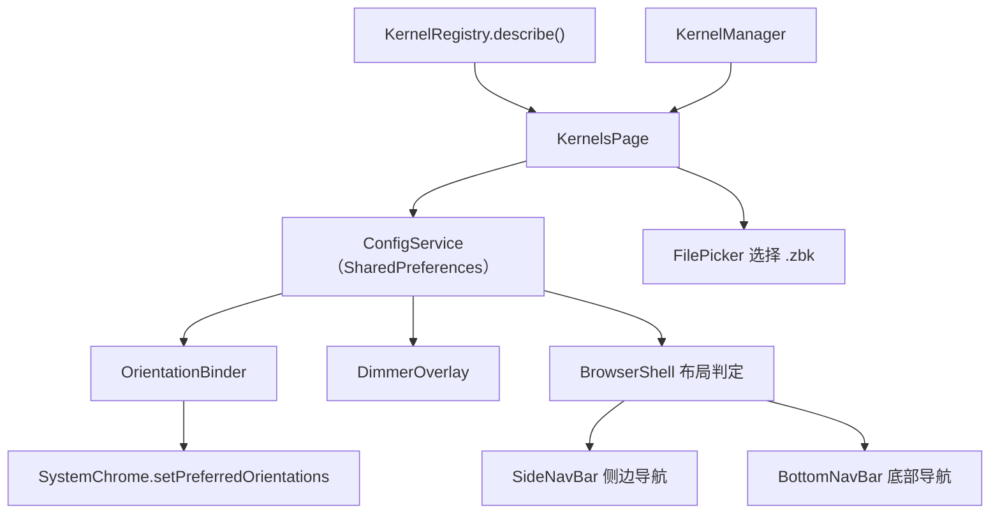

# 横屏适配、内核管理与体验增强

Feature Name: 2026-11-15-landscape-kernel-manager
Updated: 2026-11-15

## Description

本次改动覆盖四个方向：

1. 横屏布局：修正紧凑布局判定，新增横屏侧边导航栏，页面内容宽屏限宽。
2. 方向锁定：新增跟随系统 / 锁定竖屏 / 锁定横屏三态配置并在启动与切换时应用。
3. 内核管理页：列出全部候选内核，支持切换、安装 `.zbk`、卸载独立内核包。
4. 体验增强：护眼调光覆盖层、底部导航栏滑动切换标签、标签块中键关闭。

## Architecture



- 配置层：`ConfigService` 新增 `ui.orientation`（字符串枚举名）与 `ui.dimmer`（0.0–0.6 双精度）。
- 方向层：`OrientationBinder` 包裹应用根组件，监听 `ConfigService`，变化时通过 `SystemChrome.setPreferredOrientations` 应用。
- 显示层：`DimmerOverlay` 用 `Stack` 在最上层叠加 `IgnorePointer` 黑色遮罩，透明度等于配置强度。
- 布局层：`BrowserShell` 依据宽高判定紧凑布局；横屏且启用底部导航时改为左侧竖排导航。
- 内核层：`KernelsPage` 读取 `KernelRegistry.describe()` 与 `KernelManager.kernels`，写回 `ConfigService.setSelectedKernelId`。

## Components and Interfaces

### `lib/core/orientation_mode.dart`（新增）

```dart
enum AppOrientationMode { system, portrait, landscape }

AppOrientationMode parseAppOrientationMode(String? raw);

extension AppOrientationModeLabel on AppOrientationMode {
  String get label;
}

Future<void> applyAppOrientation(AppOrientationMode mode);
```

### `ConfigService`（修改）

- `AppOrientationMode get orientation` / `Future<void> setOrientation(AppOrientationMode)`
- `double get dimmer` / `Future<void> setDimmer(double)`（写入前 clamp 到 0.0–0.6）

### `lib/ui/widgets/dimmer_overlay.dart`（新增）

```dart
class DimmerOverlay extends StatelessWidget {
  const DimmerOverlay({super.key, required this.child});
  final Widget child;
}
```

### `lib/ui/pages/kernels_page.dart`（新增）

- 顶部信息卡：当前内核名称与引擎。
- 分组列表：平台默认、系统/内置内核、独立内核包、插件携带内核。
- 操作：单选切换、安装 `.zbk`、卸载独立内核包。
- 使用 `context.watch<KernelManager>()` 与 `context.watch<ConfigService>()` 刷新。

### `BrowserShell`（修改）

- 判定：`compact = width < 720 || (landscape && height < 560)`。
- `sideNav = landscape && config.bottomNavEnabled`：左侧 `_SideNavBar`，隐藏 `BottomNavBar`。

### `SettingsPage` / `AppearancePage`（修改）

- 内核卡片增加跳转内核管理页的入口。
- 外观页「浏览器界面」卡片新增方向锁定选择与护眼调光滑块。
- 设置页列表在宽度 ≥ 780 时居中限宽。

### `BottomNavBar`（修改）

- 暴露 `showBottomNavMenu(BuildContext)` 供侧边导航复用。
- 外层 `GestureDetector.onHorizontalDragEnd` 调用 `TabManager.activateNext/activatePrevious`。

### `BrowserTabBar`（修改）

- `_TabChip` 增加 `Listener`，`event.buttons == kMiddleMouseButton` 时调用 `onClose`。

## Data Models

| 键 | 类型 | 默认值 | 说明 |
| --- | --- | --- | --- |
| `ui.orientation` | String | `system` | 方向模式枚举名 |
| `ui.dimmer` | double | `0.0` | 护眼调光强度，范围 0.0–0.6 |
| `kernel.selected_id` | String? | 空 | 已选中内核 id；空表示平台默认 |

## Correctness Properties

1. 方向锁定写入后，重启应用仍返回同一模式。
2. 调光强度始终落在 0.0–0.6 区间。
3. 内核切换只影响新建标签页；已存在标签页保持原内核，界面提示该语义。
4. 卸载当前选中内核后，`selectedKernelId` 回到空值，新建标签页使用平台默认内核。
5. 侧边导航栏与底部导航栏不会同时显示。

## Error Handling

- `.zbk` 安装失败：捕获异常并通过 `SnackBar` 展示失败原因，不改变现有内核选择。
- 内核包缺失当前平台产物：列表展示不可用原因，禁用该行选中手势。
- 安装目录被篡改：页首展示告警，对应内核行标注「已拒绝加载」。
- `SystemChrome` 调用在桌面平台为空操作，无需平台判断。

## Test Strategy

- `flutter analyze` 零告警（CI 双 Flutter 版本：3.32.8 Android / 3.47.6 桌面）。
- `flutter test` 现有全部用例通过。
- 手工验证清单：横屏手机布局、方向锁定三态、内核切换后新标签页引擎、调光强度边界、底栏滑动、中键关闭。
- `python3 tool/verify_all.py` 保持通过 7 / 跳过 1。

## References

- `lib/ui/browser_shell.dart`：现有顶栏堆叠与紧凑判定。
- `lib/core/kernel/kernel_registry.dart`：候选内核枚举与内核实例创建。
- `lib/core/kernel/kernel_manager.dart`：内核包扫描、安装、卸载。
- `lib/services/config_service.dart`：配置持久化写法。
- `lib/ui/widgets/bottom_nav_bar.dart`：底部导航栏与主菜单弹层。
- `lib/ui/widgets/browser_tab_bar.dart`：标签块与标签搜索弹层。
